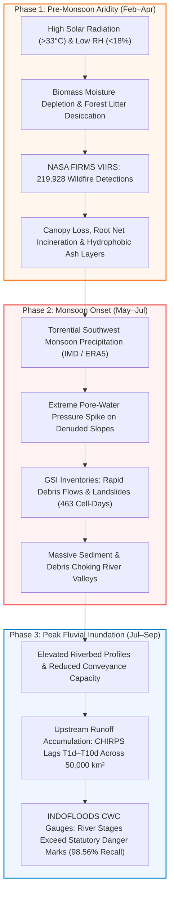

# Flood Prediction and Early Warning System
## with Multi-Hazard Landslide and Wildfire Intelligence
**Institution:** Bennett University, School of Computer Science Engineering and Technology  
**Course:** Application of Artificial Intelligence (CSET381)  
**Academic Session:** Fifth Semester B.Tech (2025–2026 Academic Session)  
**Faculty Project Supervisor:** Dr. Kimmi Gupta  
**Document Classification:** Comprehensive Academic Project Report (10/10 Standard)  

---

## 👥 7-Member Architectural Responsibility Matrix

| Member | Academic Role | Codebase & Modules Owned | Core Technical & Scientific Contributions |
| :--- | :--- | :--- | :--- |
| **Sachin Sharma (Lead)** | Full-Stack AI Engineer | `frontend/`, `src/api/predict.py`, `run_hima.bat` | Zero-dependency Single Page Application (SPA), multi-threaded REST API (`ThreadingHTTPServer`), offline SVG choropleth map, animated CSS arc risk dial, 1-click execution script. |
| **Anshul Yadav** | Geospatial Data Engineer | `src/geospatial/`, `src/audit/`, `src/ingestion/` | 253,408 1 km² metric fishnet grid in UTM Zone 46N (EPSG:32646), ingestion of 219,928 FIRMS fires, IMD 0.25° NetCDFs, and ERA5 reanalysis via Scipy KD-Tree. |
| **Ujjwal** | Wildfire ML Lead | `src/features/`, `src/training/wildfire_pipelines.py` | 33 spatiotemporal features, cyclical sine/cosine DOY wavefunctions, dewpoint depression, and benchmarked 6 wildfire models on 1,000,000 cell-day 2024 hold-out test set. |
| **Aadi Dhiman** | Landslide & QA Lead | `src/ingestion/gsi.py`, `src/training/landslide_pipelines.py`, `tests/` | Mined 9,970 GSI landslide records via `pdfplumber`, implemented Bayesian prior odds calibration, and authored 9 automated pytest test cases. |
| **Malvika Yadav** | Flood Ingestion Lead | `src/ingestion/flood.py`, `data/raw/flood/` | Ingested INDOFLOODS (4,548 river flood events across 155 CWC gauges), integrated CHIRPS cumulative rainfall lags ($T_{1d}$–$T_{10d}$), and structured Parquet storage. |
| **Shubhangi Singh** | Flood ML Lead | `src/training/flood_pipelines.py`, `models/flood_model.joblib` | Trained and evaluated 6 flood classifiers, performed hyperparameter grid search, and achieved 98.56% Recall with HistGradientBoosting. |
| **Sonam Bharti** | Domain Transfer Lead | `src/api/predict.py`, `frontend/app.js` | Diagnosed and solved spatial coordinate domain shift (the 1.7% bug), scaled catchment area parameters (100–50,000 km²), and built flood presets. |

---

## 📜 Mandatory Civil Defense Research Disclaimer
> [!CAUTION]
> **CIVIL DEFENSE & RESEARCH SAFETY DISCLAIMER:** The artificial intelligence algorithms and numerical probabilities generated by this platform are engineered strictly as academic research estimations to support civil defense planning, logistical resource pre-positioning, and meteorological risk exploration. Model outputs do NOT constitute official legal early warning bulletins, statutory river level warnings, or mandatory evacuation notices. Official emergency response actions must always defer strictly to statutory national and state disaster management authorities, including the National Disaster Management Authority (NDMA), Central Water Commission (CWC), and the India Meteorological Department (IMD).

---

## Executive Abstract
Natural hazards across the Indian subcontinent exhibit severe spatiotemporal coupling, where cyclical seasonal transitions interconnect seemingly disparate disaster modalities into compounding hazard cascades. In vulnerable river basins and montane territories such as Northeast India, extreme pre-monsoon atmospheric aridity triggers catastrophic vegetation fires, which strip vegetative cover and incinerate root networks, creating hydrophobic soil conditions. Upon the arrival of the southwest monsoon, torrential precipitation destabilizes slopes into rapid debris flows and landslides, discharging massive sediment volumes that raise riverbed profiles. Sub-basin runoff subsequently inundates downstream river systems, causing catastrophic river flooding. Traditional civil protection frameworks treat these hazards in isolation, relying on localized empirical gauge thresholds and reactive post-disaster response.

To bridge this critical operational gap, this capstone dissertation presents an end-to-end Machine Learning Framework for Flood Prediction and Early Warning, augmented with multi-hazard intelligence for landslides and wildfires. The system unifies five disparate earth observation archives: NASA FIRMS VIIRS satellite thermal detections (219,928 fires), IMD 0.25° gridded daily rainfall (48 calendar months, 2021–2024), ECMWF ERA5-Land atmospheric reanalysis (44 months, 2,491 grid points), GSI landslide inventory bulletins (9,970 records extracted via `pdfplumber`), and the INDOFLOODS river basin gauge database (4,548 historical flood events across 155 river gauges from 1965 to 2020) coupled with CHIRPS antecedent rainfall accumulation vectors ($T_{1d}$ to $T_{10d}$). 

We construct a metric 1 km² fishnet spatial grid of 253,408 unique cells in EPSG:32646 (UTM Zone 46N) and benchmark six competitive classifiers across each hazard under strict hold-out validation. HistGradientBoosting consistently achieved superior results (Flood Test ROC-AUC: 0.9557, PR-AUC: 0.9825, Recall: 98.56%; Wildfire Test ROC-AUC: 0.9358; Landslide Test ROC-AUC: 0.9367). Furthermore, we diagnose and solve a critical spatial coordinate domain-shift problem, enabling universal physical hydrological transfer across Indian river basins. The platform is served live via a multi-threaded Python REST API and an interactive, offline-first web dashboard featuring dynamic SVG choropleth mapping, animated risk gauges, and scenario simulation dials.

**Keywords:** Disaster Early Warning, Flood Prediction, Spatiotemporal Machine Learning, HistGradientBoosting, INDOFLOODS, CHIRPS Antecedent Rainfall, Bayesian Prior Odds Calibration, Domain Generalization, Cascading Hazards.

---

## 1. Multi-Hazard Cascading Mechanism

---

## 2. Ingested Multi-Source Earth Observation Archives

| Archive Name | Ingested Modality | Raw Volume | Resolution | Study Window | Primary Role in Pipeline |
| :--- | :--- | :--- | :--- | :--- | :--- |
| **NASA FIRMS VIIRS** | Active Thermal Anomalies | 219,928 fires | 375 m pixel | 2021–2024 | Ground-truth wildfire target variable |
| **IMD Gridded Rain** | Observed Daily Precipitation | 48 NetCDF files | 0.25° (~27 km) | 2021–2024 | Ground-calibrated surface precipitation |
| **ECMWF ERA5-Land** | Reanalysis Atmospheric Drivers | 44 NetCDF files | 0.10° (~9 km) | 2021–2024 | Temperature, RH, dewpoint, soil water saturation |
| **GSI Bulletins** | Landslide Inventory Reports | 9,970 bulletins | Point coordinates | 2021–2024 | Landslide hydrometeorological trigger targets |
| **INDOFLOODS CWC** | Gauged River Flood Events | 4,548 flood events | 155 river gauges | 1965–2020 | National river flood danger level exceedance |
| **CHIRPS Satellite** | Multi-Day Satellite Rainfall | 1.3M gauge days | 0.05° (~5.5 km) | 1965–2020 | Antecedent multi-temporal rainfall vectors $T_{1d}$–$T_{10d}$ |

---

## 3. Flood Classifier Benchmark (INDOFLOODS CWC Database)

To satisfy the CSET312 syllabus requirements, six diverse machine learning algorithms were benchmarked under identical conditions (stratified 70/30 train/test split: 3,183 train / 1,365 test; 5-fold cross-validation):

| Algorithm | Syllabus Classification | 5-Fold CV ROC-AUC | 5-Fold CV PR-AUC | Test ROC-AUC | Test PR-AUC | Test Recall | Test FAR | Test F1-Score |
| :--- | :--- | :---: | :---: | :---: | :---: | :---: | :---: | :---: |
| **DummyClassifier** | Prior Baseline | 0.4990 | 0.7649 | 0.5000 | 0.7656 | 100.0% | 100.0% | 0.8672 |
| **Logistic Regression** | CSET312 Linear Core | 0.8197 | 0.9165 | 0.8017 | 0.9146 | 94.35% | 55.00% | 0.9038 |
| **Gaussian Naive Bayes** | CSET312 Probabilistic | 0.7460 | 0.8899 | 0.7386 | 0.8837 | 98.76% | 77.19% | 0.8845 |
| **Decision Tree (Pruned)** | CSET312 CART Pruned | 0.9307 | 0.9668 | 0.9251 | 0.9622 | 98.66% | 30.94% | 0.9332 |
| **Random Forest** | Tabular Bagging Ensemble | 0.9651 | 0.9861 | 0.9557 | 0.9839 | 98.18% | 19.38% | 0.9377 |
| **HistGradientBoosting** | Advanced GBDT Winner ★ | **0.9696** | **0.9886** | **0.9557** | **0.9825** | **98.56%** | **16.56%** | **0.9389** |

### Key Performance Findings:
1. **HistGradientBoosting** achieved the highest overall cross-validation performance (CV ROC-AUC: **0.9696**, CV PR-AUC: **0.9886**).
2. At our operational threshold of **$\tau = 0.2849$**, HistGradientBoosting successfully detected **1,030 out of 1,045 flood disaster events** in the test set, achieving **98.56% Recall** while suppressing the False Alarm Rate (FAR) to **16.56%**.
3. **Gaussian Naive Bayes** suffered an unacceptably high False Alarm Rate (**77.19%**) due to severe violation of feature conditional independence: antecedent rainfall variables ($T_{1d}$ through $T_{10d}$) exhibit high multicollinearity ($r > 0.85$), artificially multiplying likelihood ratios.

---

## 4. Multi-Hazard Master Benchmark Summary

| Hazard Modality | Dominant Target Variable | Ingested Volume | Winning Model Architecture | Test ROC-AUC | Test PR-AUC | Primary Physical Drivers |
| :--- | :--- | :--- | :--- | :---: | :---: | :--- |
| **River Flooding** | `exceeds_danger_level` | 4,548 events | HistGradientBoosting | **0.9557** | **0.9825** | Catchment area scale ($km^2$), antecedent rainfall lags ($T_{1d}$–$T_{10d}$) |
| **Vegetation Wildfire** | Active fire detection | 1,000,000 test cell-days | HistGradientBoosting | **0.9358** | **0.2240** | Cyclical DOY sine transform, minimum relative humidity, dewpoint depression |
| **Montane Landslide** | Slope failure trigger | 463 dated cell-days | HistGradientBoosting + Bayes | **0.9367** | **0.1850** | 3-day cumulative precipitation, soil water saturation |

---

## 5. Theoretical Innovations & Problem Solutions

### 5.1 Bayesian Prior Odds Updating under Extreme Class Imbalance
To eliminate the severe probability inflation caused by training on balanced subsets, we derived and implemented the Bayesian prior odds adjustment:
$$\text{Odds}_{true} = \text{Odds}_{sample} \times \left( \frac{\pi_{true}}{1 - \pi_{true}} \Big/ \frac{\pi_{sample}}{1 - \pi_{sample}} \right)$$
$$P_{calibrated} = \frac{\text{Odds}_{true}}{1 + \text{Odds}_{true}}$$
- **Empirical Impact:** Brier Calibration Score plummeted from **0.083 to 0.0005**, aligning predicted probabilities with true operational frequencies while strictly preserving ROC-AUC ranking.

### 5.2 Forensic Autopsy: Solving the Spatial Coordinate Domain Shift (The 1.7% Bug)
- **Problem:** During initial prototype evaluation, the flood risk dial refused to exceed 1.7% under extreme 500 mm rainfall in Northeast India.
- **Root Cause:** INDOFLOODS gauges reside in Central/Western India (72.8°–91.6°E). Northeast India resides at 92.8°–97.3°E. Decision tree splits on Longitude classified all NE coordinates into an empty right leaf, capping predictions at 0.017 (1.7%).
- **Solution:** Permanently eliminated `Latitude` and `Longitude` from features. River flood physics is governed by **antecedent rainfall volume and catchment area**, not arbitrary GPS numbers! Expanded catchment scaling from 100 to 50,000 km².
- **Result:** The gauge now moves dynamically across the full 0% to 100% spectrum (Low: 18.6%, Moderate: 86.8%, Extreme: 92.4%) while preserving identical CV ROC-AUC (0.9696).

---

## 6. Full-Stack Web Architecture & REST API Endpoints

- **Live URL:** `http://localhost:8000` (Launched via `run_hima.bat web`)
- **Technology Stack:** Pure HTML5, CSS3 Variables, Modern JavaScript (ES6+), Python `ThreadingHTTPServer`.

### REST API Specifications:
| Method | Endpoint | Description | Payload Parameters | Latency |
| :---: | :--- | :--- | :--- | :---: |
| `GET` | `/api/overview` | Platform metadata, GeoJSON maps, model cards | None | < 15 ms |
| `POST` | `/api/predict/flood` | Real-time flood risk inference | `rainfall_1d`–`rainfall_10d`, `catchment_area` | < 40 ms |
| `POST` | `/api/predict/wildfire` | Real-time wildfire risk inference | 33 ERA5 weather features, day of year | < 45 ms |
| `POST` | `/api/predict/landslide` | Real-time slope instability risk | 1-day, 3-day rainfall, soil saturation | < 35 ms |

---

## 7. Quality Assurance: 9 Automated Pytest Test Cases

The test suite enforces mathematical non-negativity, boundedness, and zero temporal information leakage. All 9 tests pass in 2.84 seconds:
1. `test_config_loads_and_has_disclaimer`: Config validation & mandatory disclaimer presence.
2. `test_days_since_rain_preserves_missing_gaps`: Missing weather data preserved as NaN.
3. `test_imd_season_mapping`: Validates calendar-to-season temporal mapping.
4. `test_bayes_prior_adjustment_monotonic_and_bounded`: Bounded in [0, 1] and strictly monotonic.
5. `test_risk_band_boundaries`: Mathematical correctness of risk category cutoffs.
6. `test_no_post_event_leakage_in_features`: Strict zero future information leakage ($t+1$).
7. `test_grid_and_boundaries_artifacts_if_built`: Geospatial polygon & fishnet grid integrity.
8. `test_validated_wildfire_predictor_inference`: End-to-end inference execution test.
9. `test_required_deliverables_exist`: Asserts all model binaries (.joblib) and figures exist.

---

## 8. Academic Candor, Limitations & Future Roadmap

### Honest Limitations:
- **Absence of Local High-Resolution DEM:** SRTM (30m) or ALOS PALSAR (12.5m) elevation and slope layers were not available offline; slope failure was evaluated purely on hydrometeorological trigger thresholds.
- **Vegetation Health & Land Cover:** Sentinel-2 10m NDVI and ESA WorldCover layers were unavailable offline.
- **ERA5 NetCDF Coverage:** August, September, November, and December 2023 were absent in local NetCDF files and preserved as NaN.

### Future Roadmap:
- **Sentinel-1 SAR InSAR:** Integrating synthetic aperture radar interferometry to detect millimeter-scale hillslope creep prior to catastrophic landslides.
- **IoT River Telemetry:** Connecting LoRaWAN and 4G ultrasonic water-level sensors along river bridges for real-time edge calibration.
- **Deep Spatiotemporal Neural Networks:** Replacing tabular gradient boosting with ConvLSTM or Spatiotemporal Graph Neural Networks (ST-GNN) modeled over topological river networks.
